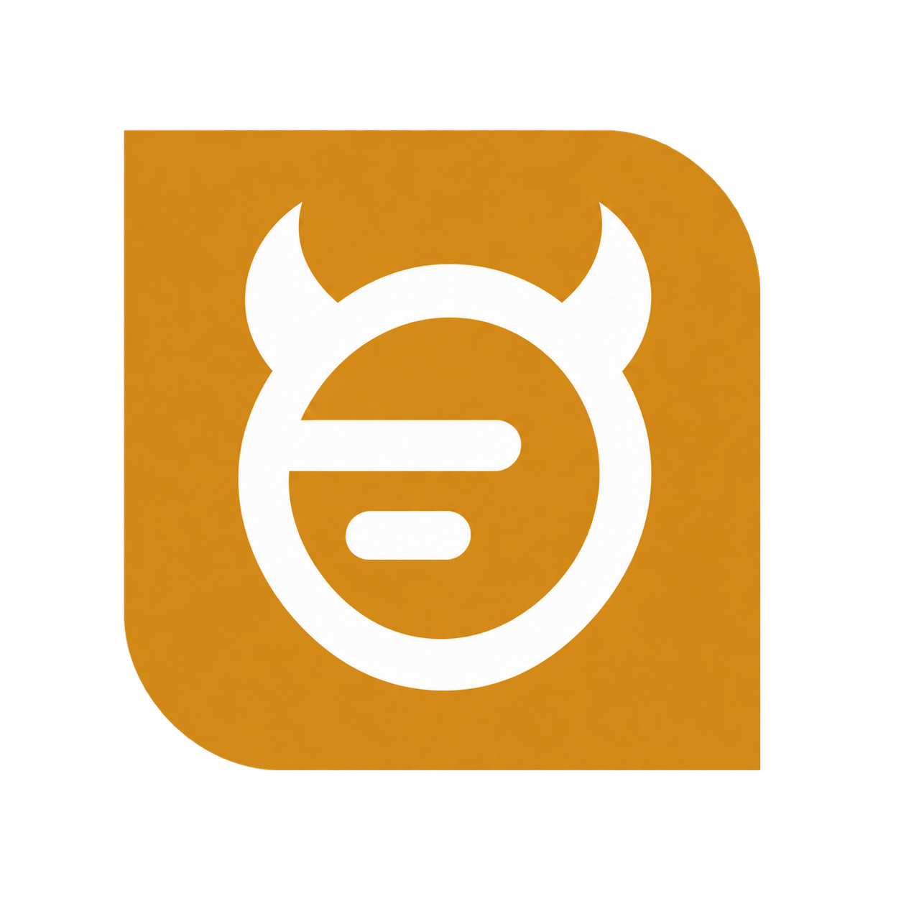
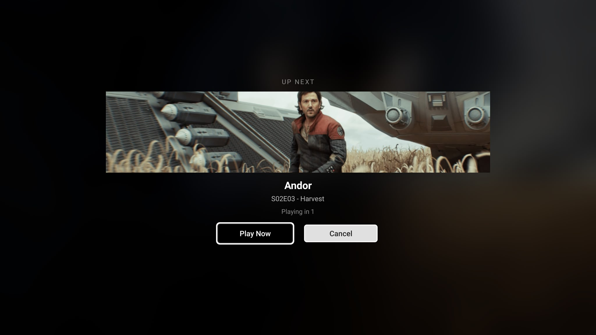
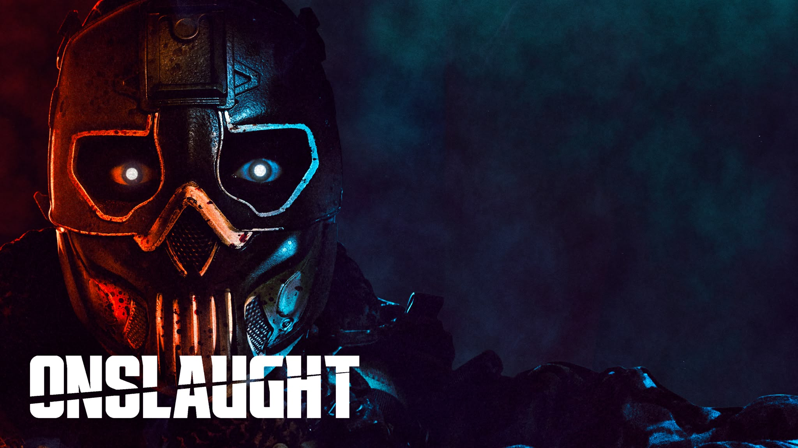
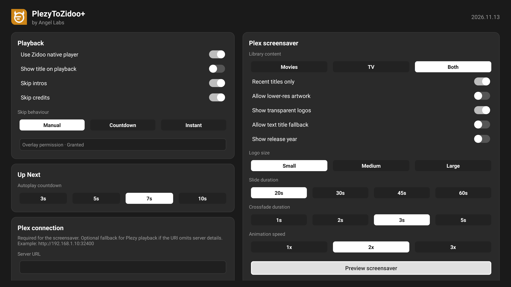
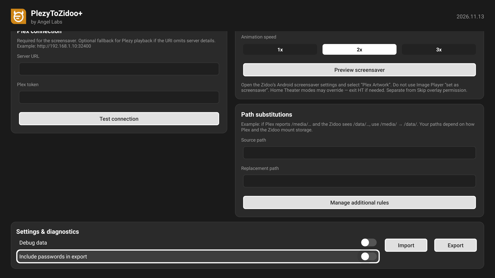
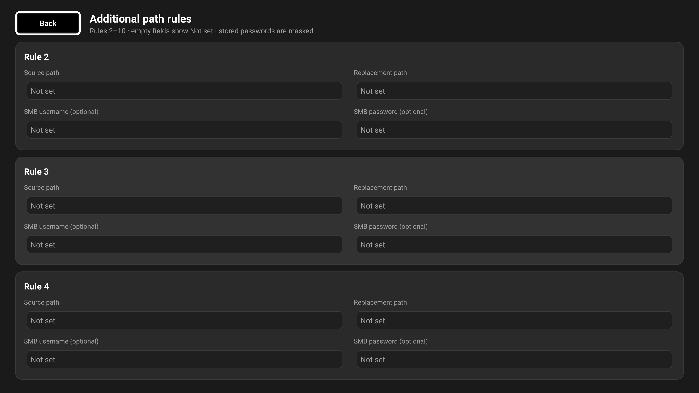

  

<h1 align="center">PlezyToZidoo+</h1>

  <strong>Plezy for browsing. Zidoo for playback. The best of both worlds.</strong>

  Enhanced native playback and Plex integration for Zidoo media players, with intro and credit skipping, Up Next autoplay, cinematic 4K Plex artwork screensavers and flexible media path mapping.

  <em>by Angel Labs</em>

  
  
  

  <a href="https://github.com/AngelLabsSoftware/PlezyToZidoo/releases"><strong>Download the latest release</strong></a>

  

  <strong>PlezyToZidoo+</strong> is a small Android app designed for the <strong>Zidoo Z9X 8K</strong>. It allows you to browse your Plex library using Plezy while enjoying the picture and sound quality of the Zidoo's native media player.

  It also brings across some of the features you might miss when using an external player, including Skip Intro, Skip Credits, Up Next and synchronised playback progress.

  As an added bonus, it includes a cinematic 4K screensaver using artwork and title logos from your own Plex library.

  This is an independent project by <strong>Angel Labs</strong>. It is not affiliated with, endorsed by, or an official product of Plezy, Plex or Zidoo.

<h2>Why I made this</h2>

  I wanted Plezy's Plex browsing experience, but with the Zidoo's native player handling the actual video and audio.

  I'd previously tried Plezy with Jellyfin and liked its intro and credits skipping, but preferred the richer Plex home screen, collections and personalised discovery rows.

  This project brings the two things together: Plezy for browsing Plex, and Zidoo for playback, without having to give up the convenience of modern streaming interfaces.

<strong>Jellyfin is not required.</strong>

  The project started as something I wanted for my own home cinema and has gradually grown to include a few other features that make the Zidoo a nicer device to use.

<h2>What it does</h2>

<table>
  <thead>
    <tr>
      <th>Feature</th>
      <th>Description</th>
    </tr>
  </thead>
  <tbody>
    <tr>
      <td>Native Zidoo playback</td>
      <td>Browse in Plezy and play using the Zidoo's native media player.</td>
    </tr>
    <tr>
      <td>Plex progress synchronisation</td>
      <td>Keeps playback progress and watched status in sync with Plex.</td>
    </tr>
    <tr>
      <td>Skip Intro</td>
      <td>Skip television intros using Plex's existing markers.</td>
    </tr>
    <tr>
      <td>Skip Credits</td>
      <td>Skip credits without missing mid-credit or post-credit scenes identified by Plex.</td>
    </tr>
    <tr>
      <td>Automatic skipping</td>
      <td>Choose between manual buttons, a 3-second countdown or instant skipping.</td>
    </tr>
    <tr>
      <td>Up Next</td>
      <td>Offers the next episode with artwork and a configurable autoplay countdown.</td>
    </tr>
    <tr>
      <td>4K screensaver</td>
      <td>Displays cinematic artwork from your own Plex library.</td>
    </tr>
    <tr>
      <td>Transparent title logos</td>
      <td>Uses original film and TV logos, with optional text fallback.</td>
    </tr>
    <tr>
      <td>Screensaver customisation</td>
      <td>Adjust logo size, slide duration, crossfade duration, animation speed and content selection.</td>
    </tr>
    <tr>
      <td>Path substitution</td>
      <td>Maps Plex server file paths to locations the Zidoo can access, with up to ten substitution rules.</td>
    </tr>
    <tr>
      <td>TV-friendly settings</td>
      <td>Compact two-column settings interface designed for remote control navigation.</td>
    </tr>
    <tr>
      <td>Settings backup</td>
      <td>Import and export your configuration, with sensitive credentials excluded by default.</td>
    </tr>
  </tbody>
</table>

<h2>Skip Intro and Skip Credits</h2>

  One of the things I particularly wanted was the ability to skip intros and credits without sacrificing the benefits of the Zidoo player.

  The app uses Plex's existing intro and credits markers and offers three ways to skip them.

<table>
  <thead>
    <tr>
      <th>Mode</th>
      <th>Behaviour</th>
    </tr>
  </thead>
  <tbody>
    <tr>
      <td>Manual Skip Button</td>
      <td>A small Skip Intro or Skip Credits button appears. Press OK to skip or Back to dismiss it.</td>
    </tr>
    <tr>
      <td>Auto-Skip with Countdown</td>
      <td>A 3-second countdown appears before automatically skipping. Press OK to skip immediately or Back to cancel.</td>
    </tr>
    <tr>
      <td>Instant Auto-Skip</td>
      <td>Skips automatically without displaying a button.</td>
    </tr>
  </tbody>
</table>

  Intro and credits skipping can be enabled or disabled individually.

<h3>Fast-forwarding and chapter skipping</h3>

  You don't have to watch an entire film or episode for the skip buttons to work.

  Fast-forward, rewind, jump to a chapter or resume playback within an intro or credits sequence and the skip functionality will become available once playback settles.

  If you dismiss a skip button, it stays dismissed for that visit to the segment. Leave the segment and return to it and skipping becomes available again.

<h3>What about Marvel films?</h3>

Not all credits are created equal!

  Many films have additional scenes during or after the credits. Rather than simply ending playback when the credits begin, PlezyToZidoo+ skips individual credits segments.

  If Plex has correctly identified multiple credits sequences, you can skip the first set of credits, enjoy the additional scene, then skip the next set of credits.

  This has been tested with Avengers, successfully skipping to the Thanos scene and then to the final shawarma restaurant scene.

  The accuracy of skipping depends on the markers provided by Plex.

<h2>Up Next</h2>

  When a TV episode finishes, the app can offer the next episode with a preview image and countdown.

  

  You can start the next episode immediately or cancel and return to browsing.

  The autoplay countdown is configurable in the app settings, with four available durations:

<ul>
  <li>3 seconds</li>
  <li>5 seconds</li>
  <li><strong>7 seconds (default)</strong></li>
  <li>10 seconds</li>
</ul>

  Skipping credits will also bring up Up Next when it genuinely completes the episode. If there is an additional scene after the credits, playback continues so you don't miss it.

  Up Next uses the same simple monochrome styling as the skip controls, designed to be easy to read and navigate from the sofa.

<h2>Plex Artwork Screensaver</h2>

  I wanted a screensaver that made the most of a large OLED television without having to maintain a separate collection of wallpapers.

  The result is a cinematic screensaver that pulls background artwork and transparent title logos directly from your Plex library.

  Artwork fills the screen, with a very subtle background zoom and gentle crossfades between titles.

  
  

  
  

  <em>Examples of artwork and transparent title logos displayed directly from a Plex library.</em>

<h3>Screensaver features</h3>

<ul>
  <li>Movies, TV shows or both.</li>
  <li>Optional filtering to titles originally released within the last two years.</li>
  <li>Genuine 4K background artwork by default.</li>
  <li>Optional lower-resolution artwork if your library has limited 4K images.</li>
  <li>Original transparent film and TV title logos.</li>
  <li>Optional text titles when a suitable logo is unavailable.</li>
  <li>Optional release year display.</li>
  <li>Adjustable logo size.</li>
  <li>Adjustable artwork display and crossfade durations.</li>
  <li>Adjustable animation speed.</li>
  <li>Subtle background movement and logo repositioning.</li>
  <li>Built-in screensaver preview.</li>
  <li>Native Android screensaver integration.</li>
</ul>

  By default, the screensaver only displays qualifying artwork with a usable transparent title logo. You can enable <strong>Allow text title fallback</strong> if you'd prefer a wider selection of titles.

  Artwork is loaded directly from Plex, with upcoming images preloaded into memory for smooth transitions. There is no separate persistent artwork cache to maintain.

<h3>Logo sizes</h3>

<table>
  <thead>
    <tr>
      <th>Size</th>
      <th>Maximum screen width</th>
      <th>Alignment</th>
    </tr>
  </thead>
  <tbody>
    <tr>
      <td>Small</td>
      <td>25%</td>
      <td>Left</td>
    </tr>
    <tr>
      <td>Medium</td>
      <td>50%</td>
      <td>Left</td>
    </tr>
    <tr>
      <td>Large</td>
      <td>80%</td>
      <td>Centre</td>
    </tr>
  </tbody>
</table>

  These are maximum sizes. Smaller logos are not unnecessarily enlarged, helping to preserve image quality.

<h3>Animation and timing</h3>

<table>
  <thead>
    <tr>
      <th>Setting</th>
      <th>Available options</th>
    </tr>
  </thead>
  <tbody>
    <tr>
      <td>Slide duration</td>
      <td>20, 30, 45 or 60 seconds</td>
    </tr>
    <tr>
      <td>Crossfade duration</td>
      <td>1, 2, 3 or 5 seconds</td>
    </tr>
    <tr>
      <td>Animation speed</td>
      <td>1x, 2x or 3x</td>
    </tr>
  </tbody>
</table>

<h3>Setting up the screensaver</h3>

  Open PlezyToZidoo+ and enter your Plex server address and token in the Plex connection settings.

  For a typical local Plex server, the address will look something like:

<pre><code>http://192.168.1.10:32400</code></pre>

  Remember to include the port number, normally <strong>32400</strong>.

  Open the <strong>Plex screensaver</strong> settings and use Preview to check that everything is working.

  To use it as your normal screensaver, open the Zidoo's native Android screensaver settings and select <strong>Plex Artwork</strong>.

  You don't need to use the Zidoo Image Player or manually download any artwork.

  Zidoo Home Theater screensaver modes may override the Android screensaver. If necessary, exit Home Theater to allow the Android screensaver to activate.

<h2>Installation</h2>

<ol>
  <li>Download the latest signed APK from <a href="https://github.com/AngelLabsSoftware/PlezyToZidoo/releases">GitHub Releases</a>.</li>
  <li>Install the APK on your Zidoo.</li>
  <li>Open PlezyToZidoo+ and configure your path substitution settings.</li>
  <li>In Plezy, configure the custom/external player package shown below.</li>
  <li>Play a film or TV episode to check that everything is working.</li>
</ol>

The external player package is:

<pre><code>com.plezyplextozidoo</code></pre>

  Although the app has been renamed to PlezyToZidoo+, the Android package ID remains unchanged to maintain compatibility with existing installations and signed updates.

<h3>Allowing the skip buttons to appear</h3>

  The skip buttons need permission to appear over the native Zidoo player.

  On the Zidoo Z9X 8K, the easiest way to grant this permission is when you first play something after installing the app.

<ol>
  <li>Start playback from Plezy.</li>
  <li>An Android settings panel should appear at the side of the screen if permission is required.</li>
  <li>Scroll towards the bottom of the application list.</li>
  <li>Select <strong>PlezyToZidoo+</strong>.</li>
  <li>Enable permission to display over other applications.</li>
</ol>

  This is required for the Manual and Countdown skip modes.

  There is also an overlay permission control within the app settings.

<h3>Updating the app</h3>

  New releases signed with the same certificate can be installed directly over your existing installation, retaining your settings.

  If you are upgrading from an older build signed with a different certificate, Android may require you to uninstall that version first.

  Export your settings before uninstalling so you can restore them afterwards.

<h3>Zidoo prerequisites</h3>

<ul>
  <li>Firmware that exposes the local player API at <code>127.0.0.1:9529</code>.</li>
  <li>Zidoo Play mode set to <strong>Single file</strong>.</li>
  <li>The Zidoo must be able to access the same media files indexed by Plex, using local paths, SMB or NFS as appropriate.</li>
</ul>

  The app has been developed and tested on a <strong>Zidoo Z9X 8K</strong>. Compatibility with other Zidoo models is not guaranteed.

<h2>App settings</h2>

  Open PlezyToZidoo+ from the Zidoo launcher to configure the app.

  The settings interface has been designed specifically for television use and remote control navigation. Related controls are grouped together in a compact two-column layout, keeping frequently used settings visible without having to navigate through multiple menus or dialogue boxes.

  

<h3>Playback</h3>

<table>
  <thead>
    <tr>
      <th>Setting</th>
      <th>Description</th>
    </tr>
  </thead>
  <tbody>
    <tr>
      <td>Use Zidoo native player</td>
      <td>Enabled by default. Uses the native Zidoo player rather than a generic Android player intent.</td>
    </tr>
    <tr>
      <td>Show title on playback</td>
      <td>Passes the film or episode title to the Zidoo player.</td>
    </tr>
    <tr>
      <td>Skip intros</td>
      <td>Enables intro skipping.</td>
    </tr>
    <tr>
      <td>Skip credits</td>
      <td>Enables credits skipping.</td>
    </tr>
    <tr>
      <td>Skip behaviour</td>
      <td>Choose Manual, Countdown or Instant skipping.</td>
    </tr>
    <tr>
      <td>Overlay permission</td>
      <td>Displays the permission status for the skip controls and provides access to permission settings when required.</td>
    </tr>
  </tbody>
</table>

<h3>Up Next</h3>

<table>
  <thead>
    <tr>
      <th>Setting</th>
      <th>Description</th>
    </tr>
  </thead>
  <tbody>
    <tr>
      <td>Autoplay countdown</td>
      <td>Choose 3, 5, 7 or 10 seconds before the next episode starts. Defaults to 7 seconds.</td>
    </tr>
  </tbody>
</table>

<h3>Plex screensaver</h3>

<table>
  <thead>
    <tr>
      <th>Setting</th>
      <th>Description</th>
    </tr>
  </thead>
  <tbody>
    <tr>
      <td>Library content</td>
      <td>Choose Movies, TV or Both.</td>
    </tr>
    <tr>
      <td>Recent titles only</td>
      <td>Restricts artwork to titles originally released within the last two years.</td>
    </tr>
    <tr>
      <td>Allow lower-res artwork</td>
      <td>Allows artwork below 4K resolution to be displayed.</td>
    </tr>
    <tr>
      <td>Show transparent logos</td>
      <td>Displays original film and TV title logos.</td>
    </tr>
    <tr>
      <td>Allow text title fallback</td>
      <td>Uses a text title when a suitable transparent logo is unavailable.</td>
    </tr>
    <tr>
      <td>Show release year</td>
      <td>Includes the release year in the screensaver display.</td>
    </tr>
    <tr>
      <td>Logo size</td>
      <td>Choose Small, Medium or Large.</td>
    </tr>
    <tr>
      <td>Slide duration</td>
      <td>Choose how long each title is displayed.</td>
    </tr>
    <tr>
      <td>Crossfade duration</td>
      <td>Adjust the transition duration between titles.</td>
    </tr>
    <tr>
      <td>Animation speed</td>
      <td>Adjust the speed of background movement.</td>
    </tr>
    <tr>
      <td>Preview screensaver</td>
      <td>Preview your current screensaver configuration immediately.</td>
    </tr>
  </tbody>
</table>

<h3>Plex connection</h3>

  

<table>
  <thead>
    <tr>
      <th>Setting</th>
      <th>Description</th>
    </tr>
  </thead>
  <tbody>
    <tr>
      <td>Server URL</td>
      <td>Your Plex server address, including the port.</td>
    </tr>
    <tr>
      <td>Plex token</td>
      <td>Your Plex authentication token, stored securely and masked in the interface. Empty fields show Not set.</td>
    </tr>
    <tr>
      <td>Test connection</td>
      <td>Checks that the app can connect to your Plex server.</td>
    </tr>
  </tbody>
</table>

  Plezy normally supplies the server address and token when starting playback. These settings provide a fallback for playback and are also required for the standalone screensaver.

<h3>Path substitution</h3>

  Plex and Zidoo don't necessarily see your media files using the same paths.

  For example, Plex might report a file path beginning with <code>/media/</code>, while the Zidoo accesses the same file through <code>/data/</code>.

  Path substitution allows you to translate one into the other.

<table>
  <thead>
    <tr>
      <th>Setting</th>
      <th>Description</th>
    </tr>
  </thead>
  <tbody>
    <tr>
      <td>Source path</td>
      <td>The prefix of the file path reported by Plex.</td>
    </tr>
    <tr>
      <td>Replacement path</td>
      <td>The equivalent prefix accessible by the Zidoo.</td>
    </tr>
    <tr>
      <td>SMB username/password</td>
      <td>Optional credentials for SMB network shares.</td>
    </tr>
  </tbody>
</table>

An example configuration:

<pre><code>/media/ → /data/</code></pre>

  Your own configuration will depend on how your Plex server and Zidoo access your media.

<h3>Additional path substitution rules</h3>

  You can configure up to ten substitution rules to accommodate different libraries, network shares and storage locations.

  

  The primary substitution rule is accessible directly from the main settings screen. Select <strong>Manage additional rules</strong> to configure rules 2–10.

  Each additional rule has its own source path, replacement path and optional SMB credentials. Rules are visually separated into individual groups, making them easier to configure and navigate using the remote control.

  Unused additional rules show <strong>Not set</strong> until you enter a value. Example paths are never treated as saved rules.

  Stored passwords are masked in the interface.

<h3>Import and export</h3>

  You can back up and restore your settings using the Import/Export feature.

Settings are saved to:

<pre><code>Downloads/PlezyPlexToZidooSettings.txt</code></pre>

  Passwords and tokens are excluded from exports by default. <strong>Include passwords in export</strong> resets to off after each export and whenever you open Settings.

  When passwords are excluded, the export also strips Plex tokens and credentials embedded in URLs.

  <strong>Important:</strong> If you choose to include passwords, the exported file contains sensitive credentials in plain text. Keep it somewhere secure and don't share it.

<h3>Debug data</h3>

  The Debug data option displays useful information about the playback request and path substitution before starting playback.

  Plex authentication tokens are redacted from the debug display.

  This can be useful if you're having problems getting the Zidoo to locate your media files.

<h2>How it works</h2>

  For anyone interested in what's happening behind the scenes:

<ol>
  <li>Plezy sends a playback request containing the Plex media URL.</li>
  <li>PlezyToZidoo+ resolves the media metadata and retrieves available intro and credits markers.</li>
  <li>Path substitution translates the media path into something the Zidoo can access.</li>
  <li>Playback is handed over to the native Zidoo player.</li>
  <li>The app monitors playback position using the Zidoo's local player API.</li>
  <li>Skip controls appear when appropriate and playback progress is reported back to Plex.</li>
  <li>When a TV episode finishes, the app can offer the next episode.</li>
</ol>

<pre>
Plezy
  |
  v
PlezyToZidoo+ ---- Plex API
  |                  Metadata, markers,
  |                  progress and artwork
  v
Zidoo native player
</pre>

  The screensaver operates independently of Plezy playback, using the configured Plex server connection to retrieve artwork.

<h2>Credit</h2>

  This project is based on <strong><a href="https://github.com/magnetgrouplabs/JellyfinToZidoo">JellyfinToZidoo</a></strong> by <a href="https://github.com/magnetgrouplabs">magnetgrouplabs</a>.

  Much of the original groundwork, including launching the Zidoo player, monitoring playback, path substitution, skip controls, next-episode functionality and settings import/export, comes from that project.

  PlezyToZidoo+ adapts that work to use the Plex HTTP API and Plezy's external player integration, with further development of the skip functionality, screensaver and user interface by <strong>Angel Labs</strong>.

  Earlier lineage also includes <a href="https://github.com/bowlingbeeg/PlexToZidoo">PlexToZidoo</a> by bowlingbeeg.

  Thanks also to the developers of <a href="https://github.com/edde746/plezy">Plezy</a> for creating such a lovely way to browse a media library.

<h2>Build from source</h2>

<pre><code>export ANDROID_HOME=~/android-sdk
./gradlew assembleRelease</code></pre>

The APK can be found in:

<pre><code>app/build/outputs/apk/release/</code></pre>

To run the unit tests:

<pre><code>./gradlew test</code></pre>

  Release builds are filtered to <code>armeabi-v7a</code>.

  Signing information for local builds is available in <a href="keystore/README.md">keystore/README.md</a>.

<h2>License</h2>

  MIT — see <a href="LICENSE">LICENSE</a>.

  Based on JellyfinToZidoo by magnetgrouplabs, with earlier lineage from PlexToZidoo by bowlingbeeg.

  

  <strong>Angel Labs</strong>

  <em>Independent software development.</em>

